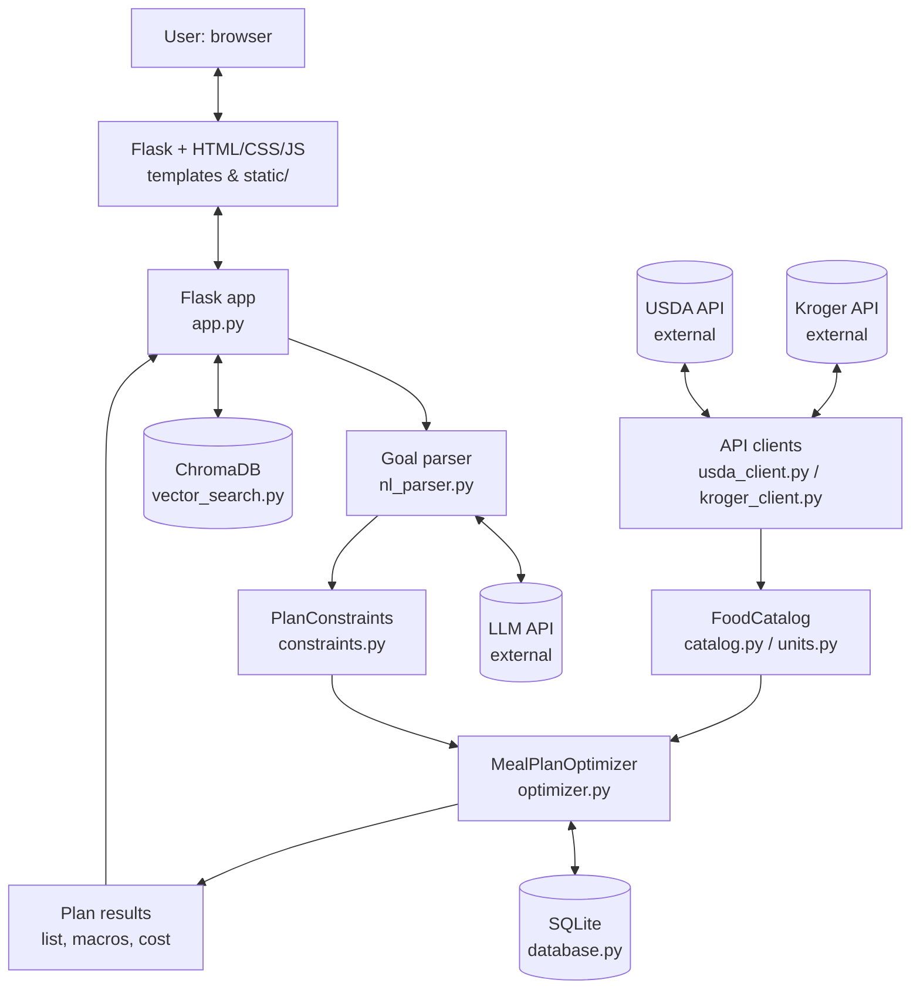

# CIS 3400 – Advanced Programming

## Project 2: Python Application Development

**Student Name:** Dominic Rueck
**Project Title:** BudgetPlate – Budget Meal-Prep Optimizer
**Course:** CIS 3400 – Advanced Programming
**Final Presentation:** December 8, 2026

---

## 1. Project Overview

**Application Name:** BudgetPlate

**Project Option:** API-Integrated Web Application (with a database and an AI component)

### Problem Statement

Students and young athletes often need to hit calorie and protein targets on a tight grocery budget, but it is hard to know which foods meet those targets for the least money. Calorie trackers mostly record what someone has already eaten, and recipe sites rarely account for real grocery prices. BudgetPlate works backwards: the user describes a goal (for example, "2,200 calories, 150 g protein, $50 a week, no dairy") and the app builds the cheapest weekly grocery list that meets it, using real nutrition data and real store prices.

### Intended Users

College students, student-athletes, and anyone meal-prepping on a limited budget. They enter a goal, choose a nearby store, and receive a grocery list with quantities, macro totals, and total cost.

### Unique Features

- Combines two external APIs (nutrition and prices) into a decision using a cost-minimizing optimization, rather than just displaying API data.
- Uses an LLM to turn a free-text goal into validated, structured constraints.
- Reports when targets are impossible within the budget and shows the minimum budget that would work.
- Stores saved plans, a pantry, and cached API data in SQLite, and supports semantic food search with a vector database.

*BudgetPlate is an educational planning tool and does not provide medical or dietary advice.*

## 2. Application Features

- **Feature 1 – Goal input:** Enter calorie, protein, and weekly budget targets plus dietary exclusions, either through a form or as free text.
- **Feature 2 – Live data:** Look up nearby stores and pull nutrition (USDA FoodData Central) and prices (Kroger Public API, which includes Harris Teeter) for a curated list of staple foods.
- **Feature 3 – Optimized plan:** Generate the lowest-cost weekly grocery list that meets the targets, with calorie, macro, and cost totals.
- **Feature 4 – Saved plans and pantry:** Save and reload plans; treat pantry items as free.
- **Feature 5 (stretch) – Semantic search:** Search foods with queries such as "cheap high-protein breakfast".

Users type or select a goal, press **Build my plan**, and receive a grocery list with totals. If the targets cannot be met, they see a clear message and the minimum feasible budget.

## 3. Technologies Used

| Technology | Purpose |
|---|---|
| Python | Main programming language |
| Flask | Web server and API routes |
| HTML / CSS / JavaScript | Browser UI (forms, plan display, client-side interaction) |
| requests | Calls to the USDA and Kroger REST APIs |
| python-dotenv | Load API keys from a local `.env` file |
| pandas / NumPy | Clean and merge nutrition and price data |
| SciPy (`linprog` / `milp`) | Cost-minimizing optimization under nutrition constraints |
| SQLite (`sqlite3`) | Cache API responses; store plans and pantry |
| ChromaDB | Vector database for semantic food search |
| anthropic (Claude API) | Convert free-text goals into structured JSON constraints |
| pytest | Automated tests, including error and edge cases |

## 4. Application Architecture



### How the Application Works

1. The user enters a goal as free text or through a form.
2. The browser sends the goal to Flask (form POST or JSON API); JavaScript can update the page without a full reload where useful.
3. `LLMConstraintParser` converts free text to JSON, and `PlanConstraints` validates it.
4. `FoodCatalog` merges nutrition data (USDA) and prices (Kroger) fetched by the API clients, using cached values from SQLite when available.
5. `MealPlanOptimizer` finds the lowest-cost list that meets the constraints, or reports that none exists.
6. Flask returns HTML (Jinja2 templates) or JSON for the front end; results are shown in the browser, and plans can be saved to SQLite.

## 5. Project Structure

*Planned structure; this will be updated*

```text
budgetplate/
├── app.py                # Flask application factory / routes
├── config.py             # Loads environment variables and settings
├── templates/            # Jinja2 HTML pages (index, plan results, errors)
│   └── base.html
├── static/
│   ├── css/              # Stylesheets
│   └── js/               # Client logic (forms, fetch to API, UI updates)
├── constraints.py        # PlanConstraints: input model and validation
├── nl_parser.py          # LLMConstraintParser: free text -> JSON constraints
├── usda_client.py        # USDAClient: nutrition lookups
├── kroger_client.py      # KrogerClient: OAuth, stores, prices
├── units.py              # Package-size parsing and cost per 100 g
├── catalog.py            # FoodCatalog / FoodItem: merged food data
├── optimizer.py          # MealPlanOptimizer (SciPy)
├── database.py           # SQLite access: cache, plans, pantry
├── vector_search.py      # FoodSearchIndex (ChromaDB)
├── data/
│   └── staples.csv       # Curated staple foods: name, USDA ID, Kroger search term, tags
├── tests/                # pytest tests
├── docs/
│   └── architecture.png
├── .env.example          # Placeholder variable names only (no real keys)
├── .gitignore            # Excludes .env and local database files
├── requirements.txt
└── README.md
```

## 6. Installation and Running the Application

```bash
git clone [repository-url]
cd budgetplate
pip install -r requirements.txt
cp .env.example .env      # then add your own API keys
export FLASK_APP=app.py   # or: flask --app app run
flask run                 # default http://127.0.0.1:5000
```

Required keys (stored only in your local `.env`, **never committed**): a USDA FoodData Central API key, Kroger developer client ID and secret, and an LLM API key.

## 7. Testing and Validation

*To be completed for the final deliverable.*

| Test | Expected Result | Actual Result |
|---|---|---|
| Normal goal input | A plan within budget that meets the targets | [Result] |
| Invalid or missing input (negative budget, empty goal) | Helpful error message | [Result] |
| Impossible targets (for example, very high protein on a very low budget) | Clear message with the minimum feasible budget | [Result] |
| API failure or missing price | Fallback to cached data or a clear message | [Result] |
| Malformed LLM output | Rejected by validation; user asked to rephrase | [Result] |

## 8. AI-Assisted Development Disclosure

**AI Tools Used:** Claude, GitHub Copilot *(update at submission)*

### How AI Was Used

*Planned:* first drafts of the API client classes, Flask routes and HTML/CSS/JS layout, and SQLite operations; troubleshooting OAuth and optimization errors; suggested test cases and README wording. The application also calls an LLM at runtime to parse goals into constraints.

### Student Contributions

*Planned:* I designed the problem, features, architecture, and constraint rules; reviewed, ran, and modified all generated code; wrote and ran tests; and integrated the APIs, optimizer, and database.

**Student statement:** I reviewed, tested, and can explain the code and technologies used in my application, including code developed with AI assistance.

## 9. Challenges and Lessons Learned

*To be completed as the project progresses.*

## 10. Application Screenshots

*To be added for the final deliverable (main interface and a generated plan).*

## 11. Project Links

**GitHub Repository:** [URL]
**Deployed Application:** [URL, if applicable]
**Demonstration Video:** [URL, if applicable]

## 12. Future Improvements

1. Support additional stores and compare prices across them.
2. Add recipe suggestions built from the optimized grocery list.

---

### Documentation Timeline

- **Deliverable 1 – November 16:** Overview, features, technologies, architecture diagram, and planned structure.
- **Deliverable 2 – November 23:** Update to reflect implementation progress and initial testing.
- **Final Deliverable – December 8:** All sections complete, setup verified, screenshots and links added.
